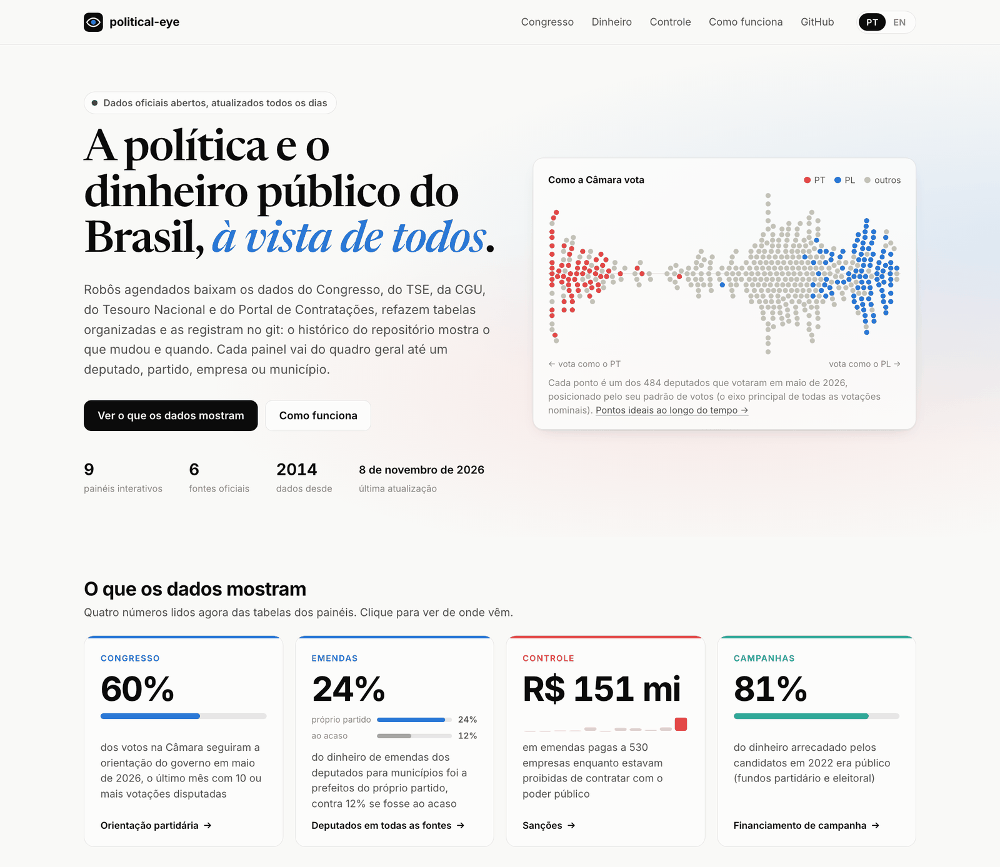
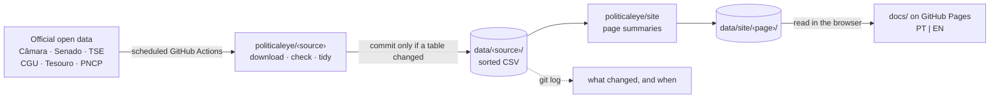

<div align="center">

# political-eye

**Brazilian politics and public money, from official open data, committed to git as it changes.**<br>
*A política e o dinheiro público do Brasil, a partir de dados oficiais abertos, registrados no git à medida que mudam.*

[**Abrir o site (português)**](https://mbottoni.github.io/political-eye/) · [**Open the site (English)**](https://mbottoni.github.io/political-eye/?lang=en) · [Methodology](METHODOLOGY.md) · [Data](data/)

[](https://github.com/mbottoni/political-eye/actions/workflows/test.yml)
[](LICENSE)
[](METHODOLOGY.md#official-data-only)
[](https://mbottoni.github.io/political-eye/)

<a href="https://mbottoni.github.io/political-eye/"><picture>
  <source media="(prefers-color-scheme: dark)" srcset="figures/site/hub-dark.png">
  
</picture></a>

</div>

Scheduled jobs download each official source (Congress, the electoral court, the comptroller general, the National
Treasury and the national procurement portal), rebuild tidy, deterministic tables and commit them only when
something changed. The repository is the dataset, and its history is a record of what changed and when: lists the
government overwrites every day, such as who is barred from public contracts, keep their past here.

On top of the tables, eleven interactive pages go from the big picture down to one deputy, party, company or town.
They run in the browser, read the data straight from this repository, and are in Portuguese with an English switch.
**Search any federal deputy from the front page** to open their profile: roll-call participation, bills filed, how
they vote and with whom, who they co-sign with, their party history, where their amendment money went and who paid
for their campaign, each ranked against every other deputy.

## What you can explore

| | Page | What it answers | Source | Data job |
|---|---|---|---|---|
| **Congress** | [Câmara dos Deputados](https://mbottoni.github.io/political-eye/camara/) | Who votes together and who signs bills together, every month since 2015, as two networks of the same deputies: communities, how far votes split along party lines, who is central, and each deputy's ideal point. | Câmara, Dados Abertos | [](https://github.com/mbottoni/political-eye/actions/workflows/camara.yml) weekly |
| | [Senado Federal](https://mbottoni.github.io/political-eye/senado/) | The same two networks for the Senate, each over the twelve months to date, and how often each senator votes with their party and the government. | Senado, Dados Abertos | [](https://github.com/mbottoni/political-eye/actions/workflows/senado.yml) weekly |
| | [Party orientations](https://mbottoni.github.io/political-eye/orientacoes/) | How often each deputy follows their party's and the government's orientation and votes with their party's majority: government support by party, cohesion, rebels, blocs. | Câmara, Dados Abertos | [](https://github.com/mbottoni/political-eye/actions/workflows/camara-blocos.yml) daily (blocs) |
| | [Deputies across sources](https://mbottoni.github.io/political-eye/deputados/) | One profile per deputy, searchable from the front page: roll-call participation, bills filed and co-signed, party history, how they vote and with whom, the amendments they sent and where the money landed (towns their party runs included), who paid for their campaign, and where they rank on each; then every deputy compared. | All of the above, joined | [](https://github.com/mbottoni/political-eye/actions/workflows/ref.yml) weekly |
| | [Deputies ranked](https://mbottoni.github.io/political-eye/ranking/) | Every federal deputy ordered by an index of recorded work, with weights you choose: roll-call participation, bills filed, rapporteur opinions and thrift with the office allowance (against deputies of the same state). It does not measure ideology, the quality of laws or honesty; red flags appear beside names, never in the score. | Câmara, Dados Abertos and CEAP | [](https://github.com/mbottoni/political-eye/actions/workflows/sancoes.yml) daily |
| **Public money** | [Campaign finance](https://mbottoni.github.io/political-eye/tse/) | Where candidates' money came from in 2018, 2022 and 2026: how party leaderships split public funds, whether women and Black candidates got their legal share, money against winning, the large donors and the companies campaigns paid. | TSE | [](https://github.com/mbottoni/political-eye/actions/workflows/tse.yml) weekly |
| | [Parliamentary amendments](https://mbottoni.github.io/political-eye/emendas/) | Every amendment since 2014: who sent it, where the money landed, how much was committed and paid, and who received it, "Pix" transfers included. | Portal da Transparência (CGU) | [](https://github.com/mbottoni/political-eye/actions/workflows/emendas.yml) daily |
| | [Public contracts](https://mbottoni.github.io/political-eye/pncp/) | Who buys and who sells in contracts of R$ 1 million or more: concentration, contracts signed with barred companies, money per inhabitant, towns by their mayor's party. *History since 2021 still being read.* | PNCP | [](https://github.com/mbottoni/political-eye/actions/workflows/pncp.yml) daily |
| | [Municipal finances](https://mbottoni.github.io/political-eye/siconfi/) | Which of the 5,570 towns break the legal caps on payroll or end the year without free cash, whether "Pix" amendments go to towns in trouble, towns by their mayor's party. *History since 2015 still being read.* | Tesouro Nacional, Siconfi | [](https://github.com/mbottoni/political-eye/actions/workflows/siconfi.yml) twice a day |
| | [My town](https://mbottoni.github.io/political-eye/municipios/) | One profile per town, searchable from the front page: who was elected mayor each term, the amendment money the town government received ("Pix" included), from which members of Congress and parties and whether from the mayor's, the contracts its bodies signed and those with barred companies, its payroll and cash; each number against towns of the same state and of similar size. | All of the above, joined | [](https://github.com/mbottoni/political-eye/actions/workflows/sancoes.yml) daily |
| **Accountability** | [Sanctions](https://mbottoni.github.io/political-eye/sancoes/) | Who is barred from public contracts or fined for corruption (CEIS, CNEP, CEPIM, leniency agreements), by whom and for how long: repeat offenders, fines, leniency deals, and the amendments and contracts barred companies still get, by member of Congress and by party. | CGU | [](https://github.com/mbottoni/political-eye/actions/workflows/sancoes.yml) daily |
| | [Red flags](https://mbottoni.github.io/political-eye/alertas/) | Patterns across the sources that deserve a closer look: amendments and contracts for companies barred at the time, campaign suppliers later paid from the same member's amendments, amendment money concentrated on one private recipient, buyers dominated by one supplier, contracts after a leniency agreement. Each with its rule, its baseline and the innocent explanations: a flag is not evidence of an irregularity. | All of the above, joined | [](https://github.com/mbottoni/political-eye/actions/workflows/sancoes.yml) daily |
| | STF case reviews | How long each justice holds a case after asking for more time. *On hold: the court's server only answers web browsers.* | STF, Corte Aberta | – |

Each page's footer links the methodology behind every number on it.

## How it works



- **One source, one directory, one job.** Each source has its code in `politicaleye/<source>/`, its tables in `data/<source>/`, its rules in `methodology/<source>.md`, its tests in `tests/<source>/` and its own scheduled workflow. Commits start with the source's name (`sancoes: update through 2026-11-08`).
- **Deterministic tables.** Sorted CSV with fixed line endings: a rebuild that changes nothing makes no commit, so every diff is a real change at the source, corrections included.
- **Summaries follow the code.** When the code that builds a page changes on main, `site.yml` rebuilds every page's summaries; a long run that started before the change rebuilds its page with the new code before it pushes.
- **Provenance.** `data/<source>/sources.json` records every file and API response a build used (URL, size, ETag or SHA-256). Raw downloads stay in a git-ignored cache.
- **Checked against itself.** The network numbers the pages compute in the browser are tested against the Python build on every push (`tests/*/parity.mjs`), and every page and tab is loaded in headless Chrome in both languages (`tests/pages_smoke.py`).

## Principles

- **Official data only.** Every table comes from a government publisher's open data, named with its URLs in the source's methodology.
- **Every rule is written down.** [METHODOLOGY.md](METHODOLOGY.md) and `methodology/*.md` record each rule that changes a number and each problem found in the data: values published thousands of times too large, towns whose "Pix" amendments the official breakdown misses, parties that merged.
- **People's data.** Public officials and companies are named the way their sources publish them. No private individual's full CPF is ever committed; sanctioned people are counted, never named, and individual firms named after a person have the name withheld.
- **Say what is missing.** Where a history is still being read, the pages say how much is covered.

## Use the data

Every table is a plain CSV you can read straight from GitHub:

```python
import pandas as pd

RAW = "https://raw.githubusercontent.com/mbottoni/political-eye/main/data/"
months = pd.read_csv(RAW + "camara/index.csv")          # one row per month: roll calls, networks, party discipline
deputies = pd.read_csv(RAW + "views/deputados_57.csv")  # one row per deputy: votes, amendments, campaign money
barred = pd.read_csv(RAW + "sancoes/ceis.csv", dtype=str)  # today's list of barred companies and people
```

| Directory | What it holds |
|---|---|
| [`data/camara/`](data/camara) · [`data/senado/`](data/senado) | Roll calls, every member's vote, party and government orientations, bill authorship, blocs, each deputy's office-allowance spending; a monthly index |
| [`data/emendas/`](data/emendas) | Every amendment since 2014, its payments and recipients, by author and by town |
| [`data/tse/`](data/tse) | Campaign revenue and spending of the 2018, 2022 and 2026 general elections |
| [`data/sancoes/`](data/sancoes) | CEIS, CNEP, CEPIM and leniency agreements as published each day, and a log of what changed |
| [`data/siconfi/`](data/siconfi) | Each town's payroll against the legal limits and its cash, from its fiscal reports |
| [`data/pncp/`](data/pncp) | Contracts of R$ 1 million or more, every contract signed with a sanctioned company, daily totals |
| [`data/ref/`](data/ref) · [`data/views/`](data/views) | One politician across sources, every elected mayor since 2016; one row per deputy, one per town and year |
| [`data/site/`](data/site) | The small summaries the pages draw |

To see how a list changed, ask git: `git log -p -- data/sancoes/ceis.csv`.

## Run it yourself

Needs Python 3.11+ and [uv](https://docs.astral.sh/uv/); Node and Chrome only for the browser tests.

```bash
git clone https://github.com/mbottoni/political-eye && cd political-eye
uv sync

uv run python -m politicaleye -h                  # every source and its commands
uv run python -m politicaleye sancoes update       # download one source and rebuild its tables
uv run python -m politicaleye site build sancoes   # rebuild a page's summaries

python3 -m http.server 8000                        # then open http://localhost:8000/docs/
```

On `localhost` the pages read your local `data/`; anywhere else they read this repository on GitHub.

```bash
uv run pytest                          # builders, rules and edge cases
node tests/camara/parity.mjs           # the browser reproduces the Python network numbers
node tests/senado/parity.mjs
uv run python tests/pages_smoke.py     # every page and tab loads (needs Chrome)
```

<details>
<summary><b>Repository layout</b></summary>

```
politicaleye/            the Python package: python -m politicaleye <source> <command>
  fetch.py io.py paths.py   shared download (resumable, checked), CSV and path helpers
  camara/ senado/ emendas/ sancoes/ tse/ siconfi/ pncp/   one package per source
  ref/ views/            reference tables and joins across sources
  site/                  the pages' summaries (data/site/) and maps
data/                    every table, as committed by the jobs
docs/                    the site (GitHub Pages): index.html, one folder per page
  lib/                   shared kit: ui.js, charts.js, i18n.js, page.js, site.css, maps
methodology/             one file per source: every rule and data problem
figures/                 images regenerated by the jobs, and the README's
tests/                   pytest per source, parity tests, page smoke test
.github/workflows/       one scheduled job per source, plus tests
```

</details>

## Em português

O **political-eye** acompanha a política e o dinheiro público do Brasil com dados oficiais abertos: votações e redes
no Congresso, disciplina partidária, financiamento de campanha, emendas parlamentares, contratos públicos, finanças
municipais e sanções. Robôs agendados no GitHub Actions baixam cada fonte, refazem tabelas organizadas e as registram
no git só quando algo muda, então o histórico do repositório mostra o que mudou e quando. O
[site](https://mbottoni.github.io/political-eye/) está em português, com versão em inglês, e cada número tem a regra
que o produz descrita na [metodologia](METHODOLOGY.md).

## License

Code under the [MIT license](LICENSE). The data are public records from the Brazilian government publishers named in
each source's methodology; each `sources.json` says exactly where every table came from.

<a href="https://mbottoni.github.io/political-eye/camara/"><picture>
  <source media="(prefers-color-scheme: dark)" srcset="figures/camara/network-dark.png">
  
</picture></a>
