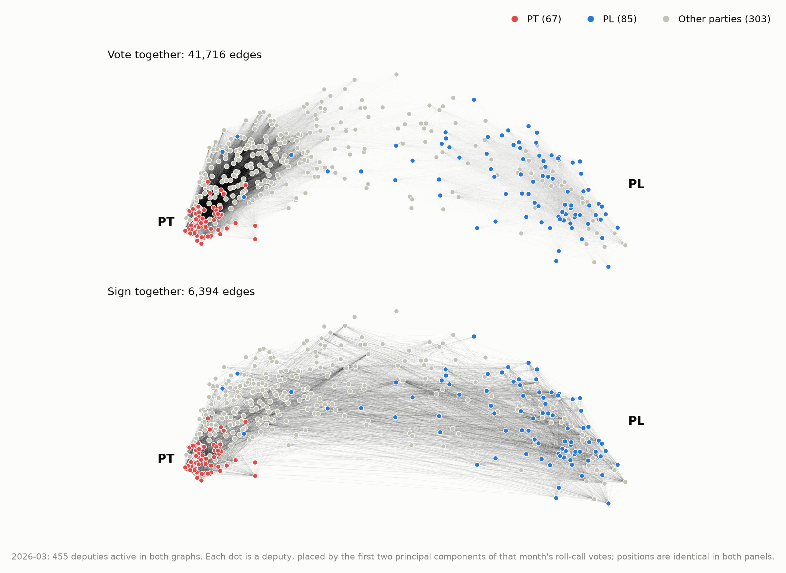
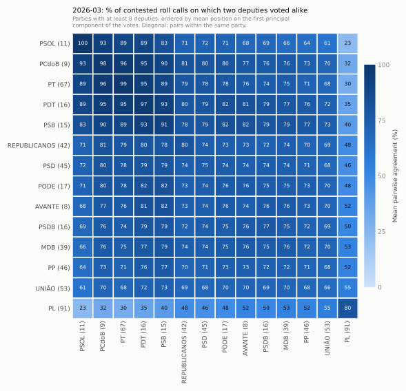
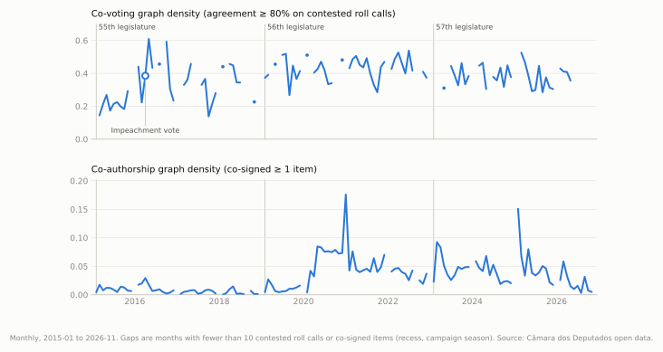

# camara-graphs

**Brazil's Chamber of Deputies, one month at a time, as two graphs on the same deputies: who votes together, and who signs together.**

Built from the Câmara's official open data, from 2015 onward, and rebuilt every week by CI. The git history of `data/` is the history of the record, including the Câmara's own corrections.

It is meant for graph statistics on real, paired and evolving networks:

- **Model fitting:** fit a random-graph model to each month and track how its parameters move.
- **Dependence testing:** test dependence between co-voting and co-authorship, which share one vertex set.
- **Change points:** look for structural breaks around the 2016 impeachment and the 2019 and 2023 turnovers of the house, with the 2027 turnover still to come.

## See it

The charts below are re-rendered by CI after every weekly update.

**The latest full month as two graphs on the same deputies.** Each dot is a deputy, placed by how they voted. The top panel links deputies who voted alike on at least 80% of contested roll calls. The bottom panel links deputies who co-signed a proposição.

The two graphs are related but far from copies of each other:

- Pairs who co-sign are more likely than random pairs to also vote together. This held in every month since 2015 with at least 30 contested roll calls (as of November 2026), though sometimes only barely.
- Most pairs who vote together never co-sign.

<picture>
  <source media="(prefers-color-scheme: dark)" srcset="figures/network-dark.png">
  
</picture>

**How often each pair of parties votes alike** in that month. Parties are ordered from the government side to the opposition.

<picture>
  <source media="(prefers-color-scheme: dark)" srcset="figures/parties-dark.svg">
  
</picture>

**Every month since 2015.** Gaps are recesses and election campaigns.

<picture>
  <source media="(prefers-color-scheme: dark)" srcset="figures/timeline-dark.svg">
  
</picture>

### Browse the tables

GitHub shows the smaller CSVs as searchable tables. To get one, open a file, or click **Raw** and save it.

| what | file |
|---|---|
| one row per month: roll calls, graph sizes and densities | [`data/index.csv`](data/index.csv) |
| deputies active in a month, with party and state | [`data/deputies/`](data/deputies) |
| that month's roll calls, with what was voted | [`data/votacoes/`](data/votacoes) |
| every deputy's vote | [`data/votes/`](data/votes) |
| every deputy signature on a proposição | [`data/authorship/`](data/authorship) |

## Quick start

```bash
git clone https://github.com/mbottoni/camara-graphs && cd camara-graphs
uv sync
```

```python
import camaragraphs as cg

G = cg.graph("2025-09", "covote")          # networkx.Graph, nodes are deputy ids
G.nodes[204379]                             # {'name': 'Acácio Favacho', 'party': 'MDB', 'uf': 'AP'}

gv, gc = cg.aligned("2025-09")              # both graphs on the same vertex set

for month, G in cg.series("covote", start="2023-02"):
    ...                                     # every month of the 57th legislature

cg.covote_edges("2025-09")                  # weighted: n_shared, n_agree, agreement per pair
cg.cosponsor_edges("2025-09", types={"PL", "PLP", "PEC"})   # bills only
```

From the shell: `uv run camaragraphs export 2025-09 --kind cosponsor > edges.csv`.

Without cloning, install with `pip install git+https://github.com/mbottoni/camara-graphs` and pass `data_dir="https://raw.githubusercontent.com/mbottoni/camara-graphs/main/data"` to any function.

## The two graphs

| graph | edge between two deputies when… | defaults | nodes |
|---|---|---|---|
| `covote` | they agreed on at least `tau` of the contested Plenário roll calls both cast | `tau=0.8`, at least 10 shared votes, votes with under 2.5% minority dropped | deputies with at least 10 contested votes that month |
| `cosponsor` | they co-signed at least `min_items` proposições that month | `min_items=1`; items with more than 50 deputy signers (signature drives) and procedural types RPD and DOC dropped | deputies who signed anything that month |

Edges carry their evidence: `n_shared`, `n_agree` and `agreement` on co-voting edges, and `n_items` and Newman's `weight` on co-authorship edges. Nodes carry `name`, `party` and `uf`.

Every default is a parameter. **[METHODOLOGY.md](METHODOLOGY.md)** gives the reasons for each, and how much it moves the graph.

## Coverage

<!-- BEGIN:COVERAGE -->
| legislatura | from → to | months | roll calls | contested | co-signed items |
|---|---|---:|---:|---:|---:|
| 54 | 2015-01 → 2015-01 | 1 | 0 | 0 | 0 |
| 55 | 2015-02 → 2019-01 | 48 | 816 | 705 | 3,658 |
| 56 | 2019-02 → 2023-01 | 48 | 1,971 | 1,723 | 10,326 |
| 57 | 2023-02 → 2026-11 | 46 | 1,128 | 1,039 | 11,232 |
<!-- END:COVERAGE -->

## Latest months

Generated by CI. All months are in [`data/index.csv`](data/index.csv). Months in recess (January, late July) and campaign months in election years have few roll calls, so check `contested` before trusting one.

<!-- BEGIN:RECENT -->
| month | roll calls (contested) | co-voting nodes | edges | density | mean agreement | co-authorship nodes | edges | density | aligned nodes |
|---|---:|---:|---:|---:|---:|---:|---:|---:|---:|
| 2026-11 | 0 (0) | 0 | 0 | 0.000 | -- | 151 | 57 | 0.005 | 0 |
| 2026-10 | 3 (2) | 0 | 0 | 0.000 | -- | 309 | 345 | 0.007 | 0 |
| 2026-09 | 3 (2) | 0 | 0 | 0.000 | -- | 226 | 800 | 0.032 | 0 |
| 2026-08 | 5 (5) | 0 | 0 | 0.000 | -- | 432 | 310 | 0.003 | 0 |
| 2026-07 | 6 (5) | 0 | 0 | 0.000 | -- | 406 | 1,287 | 0.016 | 0 |
| 2026-06 | 7 (7) | 0 | 0 | 0.000 | -- | 458 | 1,042 | 0.010 | 0 |
| 2026-05 | 24 (20) | 484 | 41,572 | 0.356 | 0.658 | 488 | 1,772 | 0.015 | 454 |
| 2026-04 | 19 (17) | 435 | 38,543 | 0.408 | 0.715 | 474 | 3,703 | 0.033 | 401 |
| 2026-03 | 41 (39) | 503 | 51,903 | 0.411 | 0.653 | 475 | 6,590 | 0.059 | 455 |
| 2026-02 | 18 (18) | 443 | 42,049 | 0.429 | 0.652 | 484 | 3,003 | 0.026 | 415 |
| 2026-01 | 0 (0) | 0 | 0 | 0.000 | -- | 1 | 0 | 0.000 | 0 |
| 2025-12 | 44 (38) | 503 | 38,503 | 0.305 | 0.607 | 493 | 2,081 | 0.017 | 480 |
<!-- END:RECENT -->

## What is stored

Graphs are not stored. Every pair of deputies, every month, would be about 270 MB of CSV. Instead `data/` holds the tidy inputs, and a graph is a sub-second function of them:

```
data/
  votacoes/YYYY-MM.csv    Plenário roll calls: id, data, hora_registro, aprovacao, votos_sim, votos_nao, votos_outros, descricao
  votes/YYYY-MM.csv       votacao_id, deputado_id, voto (Sim | Não | Obstrução | Abstenção | Artigo 17)
  authorship/YYYY-MM.csv  proposicao_id, sigla_tipo, data_apresentacao, deputado_id, ordem_assinatura, proponente
  deputies/YYYY-MM.csv    deputado_id, nome, partido, uf, n_votes, n_authored
  index.csv               one row per month: counts, densities, aligned vertex-set size
  sources.json            ETag, size and Last-Modified of every raw file used
figures/                  the charts above, light and dark (camaragraphs figures)
```

The files are sorted and rebuilt deterministically, so `git log -p data/votes/2025-09.csv` shows exactly what the Câmara changed and when.

## How it updates

`.github/workflows/update.yml` runs every Saturday, after the week's sessions (Plenário votes Tuesday to Thursday):

1. It downloads the previous and current year's bulk files. The server drops long transfers, so downloads resume with `Range` + `If-Range`.
2. It rebuilds those years and refreshes the index, the tables and the charts above.
3. It commits only if a table or chart changed. Rendering is byte-deterministic, so an unchanged month never produces a commit.

To rebuild other years, run the workflow by hand with `years` set, or run locally:

```bash
uv run python -m camaragraphs update 2015 2016 2017   # any years
```

## Source and license

Data: [Câmara dos Deputados, Dados Abertos](https://dadosabertos.camara.leg.br/). Code: MIT.
