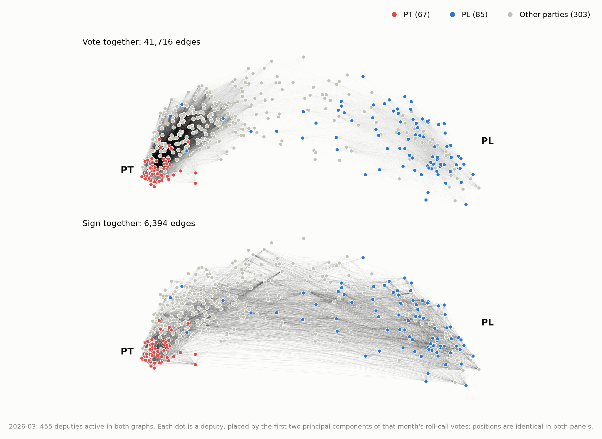

**[Open political-eye →](https://mbottoni.github.io/political-eye/)**

Brazilian politics and public money from official open data, committed as it changes.

| source | status |
|---|---|
| [Câmara dos Deputados](https://mbottoni.github.io/political-eye/camara/): who votes and who signs together | weekly |
| [Câmara party orientations](https://github.com/mbottoni/political-eye/blob/main/methodology/camara.md#party-orientations): how often each deputy votes with their party and with the government | weekly |
| Senado: the same graphs for the Senate | planned |
| Parliamentary amendments (emendas, including "Pix" transfers) | planned |
| Sanctioned companies (CEIS, CNEP) | planned |
| Campaign finance (TSE) | planned |
| Municipal finances (Siconfi) | planned |
| STF: how long justices hold cases | planned |
| Public procurement (PNCP) | planned |

<a href="https://mbottoni.github.io/political-eye/camara/"><picture>
  <source media="(prefers-color-scheme: dark)" srcset="figures/camara/network-dark.png">
  
</picture></a>
